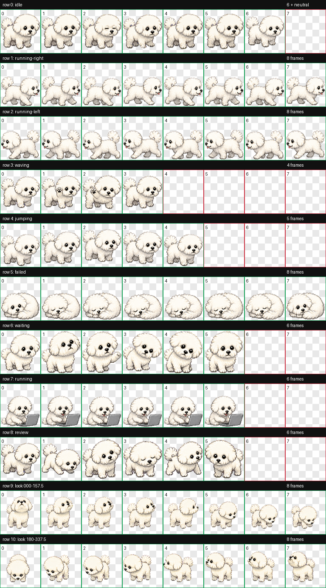

# 我的小狗 · Codex 桌面宠物

一只圆滚滚的白色小狗。待机时会小幅踏步和眨眼，也会等待、工作、睡觉并环顾四周。

本仓库保存当前本机安装的宠物版本，使用 v2 精灵图格式。

## 动画预览




## 文件

```text
my-dog/
├── pet.json           # 宠物名称、描述及精灵图配置
└── spritesheet.webp   # 带透明背景的动画精灵图
preview/               # 动画与动作预览
my-dog-codex-pet.zip    # 可直接解压的宠物包
```

## 安装

适用于支持本地自定义宠物目录的 Codex 桌面版本。

1. 下载 `my-dog-codex-pet.zip` 并解压。
2. 将完整的 `my-dog` 文件夹放入用户目录下的 `.codex/pets/`。
3. 最终路径应为 `.codex/pets/my-dog/pet.json` 和 `.codex/pets/my-dog/spritesheet.webp`。
4. 如列表未刷新，重启桌面应用，再在宠物选择界面选择「我的小狗」。

Windows 对应位置：`%USERPROFILE%\.codex\pets\my-dog\`。
如果该位置已有同名宠物，请先备份原文件夹，再替换。

## 格式信息

- 宠物 ID：`my-dog`
- 显示名称：我的小狗
- 精灵图版本：`2`
- 精灵图尺寸：`1536 × 2288`
- 图片格式：WebP，RGBA 透明背景

本仓库仅包含宠物素材、配置和预览文件。
